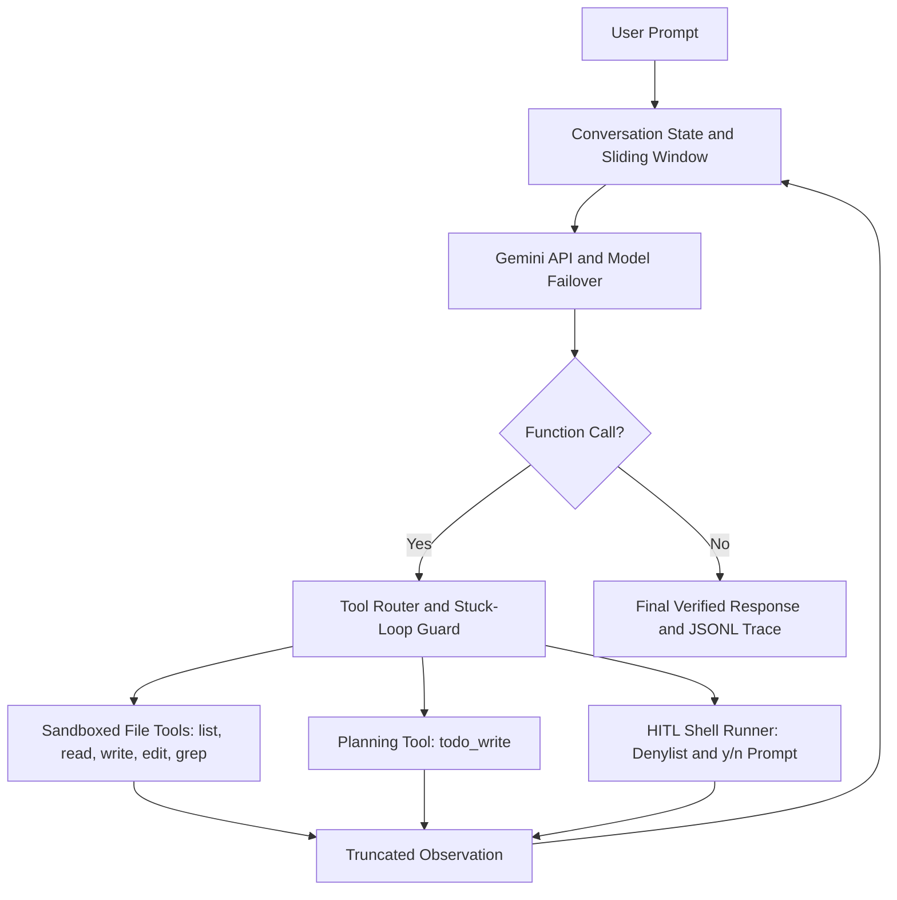

# AIVAR Personal AI Coding Agent

A terminal-based autonomous AI software engineering agent built from scratch in Python using the official `google-genai` SDK. Rather than relying on black-box agent frameworks, this project implements an explicit **ReAct (`Observe -> Reason -> Act`)** control loop with sandboxed filesystem tools, surgical file editing, repository regex search, live task planning, human-in-the-loop (HITL) command approval, and an automated 6-task evaluation harness.

## System Architecture



## Key Capabilities

* **Explicit ReAct Loop (`agent.py`):** Disables SDK Automatic Function Calling (`disable=True`) for deterministic step budgets (`max_steps=15`), structured Rich logging, stuck-loop detection, sliding-window history trimming, and multi-model failover across Gemini Flash models.
* **Hardened Workspace Sandbox (`tools.py`):** Anchors `WORKSPACE_DIR` to `Path(__file__).resolve().parent / "workspace"` and validates every path via `Path.resolve().is_relative_to()` with symlink rejection.
* **Developer Toolset:** Supports recursive `list_files`, binary-safe `read_file`, `write_file`, unique-match `edit_file`, `grep_search`, live terminal checklist `todo_write`, and `run_command` protected by a command denylist and `[y/n]` confirmation.
* **Automated Evaluation Suite (`evals/run_evals.py`):** Benchmarks end-to-end reliability across 6 coding, refactoring, data-cleaning, and security tasks (**100% pass rate**).

## Setup & Installation

1. **Clone the repository and create a virtual environment:**
   ```bash
   git clone https://github.com/Harini-Manickaraj/aivar-coding-agent.git
   cd aivar-coding-agent
   python -m venv venv
   # Windows:
   .\venv\Scripts\Activate.ps1
   # macOS/Linux:
   source venv/bin/activate
   ```
2. **Install dependencies:**
   ```bash
   pip install -r requirements.txt
   ```
3. **Configure your API key:**
   ```bash
   cp .env.example .env
   # Add your GEMINI_API_KEY inside .env
   ```

## Usage

```bash
python agent.py                                          # Run the interactive coding agent
python evals/run_evals.py                                 # Run the automated 6-task benchmark suite
python -m unittest tests/test_security.py                 # Run security & tool unit tests
```
