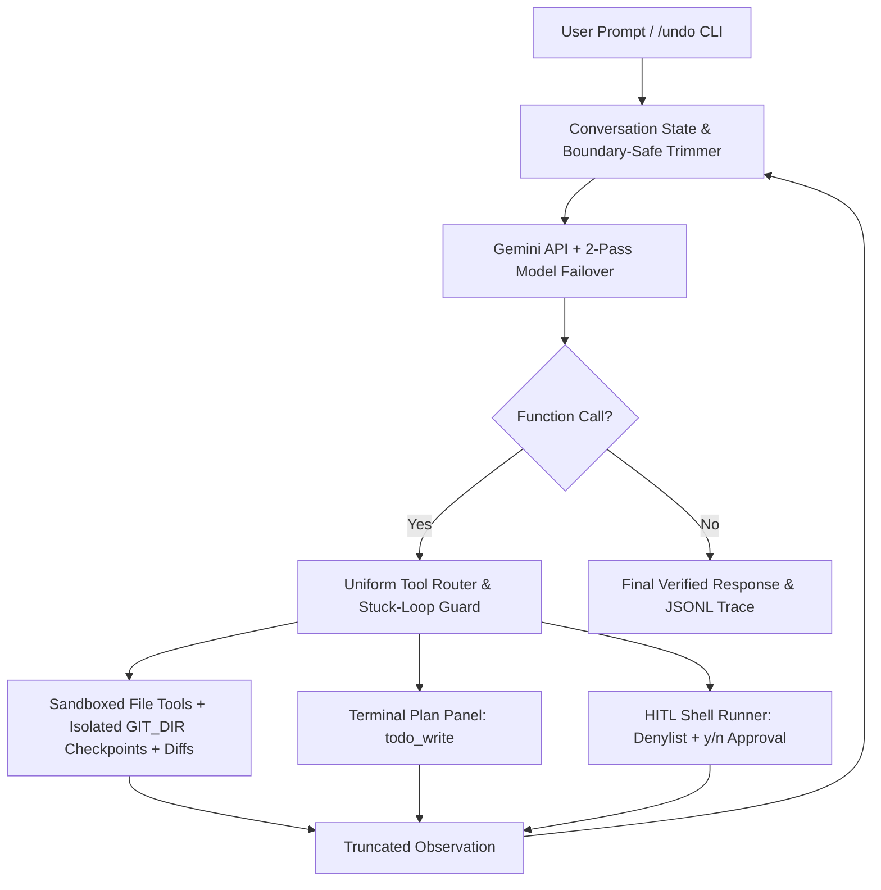

# Technical Project Report: AIVAR Autonomous AI Coding Agent

## 1. Problem Statement
Standard chat-based LLM interfaces generate static code snippets that require manual copy-pasting, file creation, execution, and error pasting by the developer. The objective of Project 1 is to build an autonomous, terminal-based coding agent from the ground up that inspects a project workspace, plans multi-step edits, previews unified diffs, creates isolated Git rollback checkpoints, executes tests under human supervision, and self-debugs from `STDERR` tracebacks.

## 2. System Architecture & Design Decisions



### Key Architectural Choices
* **Manual ReAct Loop vs. Automatic Function Calling (AFC):** We disabled SDK Automatic Function Calling (`AutomaticFunctionCallingConfig(disable=True)`) and wrote the `while` loop in `agent.py` to intercept `run_command` for `[y/n]` human approval, enforce `max_steps=15` (appending a closing `model` turn on timeout so Gemini's `user -> model` role alternation remains valid), detect 3x repeated tool calls, and record per-step telemetry.
* **Isolated Workspace Git Checkpoints & `/undo`:** `tools.py` pins every Git command explicitly via `GIT_DIR=workspace/.git` and `GIT_WORK_TREE=workspace` (while blocking direct agent access to `.git` via `_safe_path`). Every `write_file` and `edit_file` commits paired `before` and `after` snapshots, returns a unified diff on edits, and supports step-by-step rollback via `/undo`.
* **2-Pass Model Failover & HTTP Timeout:** `call_gemini` configures a 30-second HTTP timeout (`timeout=30000` ms) and rotates across `gemini-3.5-flash-lite`, `gemini-3.8-flash`, `gemini-3.7-flash`, and `gemini-3.6-flash` over two retry passes with backoff, separating transient `429`/`503`/`504` outages from fatal `400`/`401` errors.
* **Low Temperature (`0.2`):** Deterministic token selection prevents whitespace mismatches in `edit_file` (`old_str` unique matching) and malformed JSON tool arguments.

### Tool Schema & Prompt Design
The system prompt instructs the model to inspect (`list_files` / `grep_search`) before editing, prefer `edit_file` over full overwrites on existing files, verify changes with `run_command`, and load project-level conventions from `workspace/AGENT.md` when present.

| Tool Name | Parameters | Purpose & Safety Guard |
| :--- | :--- | :--- |
| `list_files` | `directory: str = "."` | Lists workspace files/folders; skips `.git` and `__pycache__`; enforces `_safe_path`. |
| `read_file` | `file_path: str` | Reads UTF-8 text inside `workspace/`; rejects binary files via null-byte check. |
| `write_file` | `file_path: str, content: str` | Creates/overwrites files after saving a pre-edit Git checkpoint in `workspace/.git`. |
| `edit_file` | `file_path: str, old_str: str, new_str: str` | Fails unless `old_str` matches **exactly once**, saves a Git checkpoint, and returns a unified diff. |
| `grep_search` | `pattern: str, directory: str = "."` | Regex search across workspace text files (capped at 100 matches). |
| `todo_write` | `tasks: list[str], completed: list[str]` | Renders a live Rich checklist panel (`?? Agent Plan`) in the terminal. |
| `run_command` | `command: str` | Runs shell commands in `workspace/` after regex `COMMAND_DENYLIST` check and mandatory `[y/n]` HITL prompt. |

### Comparison Against Claude Code & Cursor
| Capability | AIVAR Coding Agent (Project 1) | Claude Code / Cursor Agent |
| :--- | :--- | :--- |
| **Execution Loop & Edits** | Custom ReAct loop, `edit_file` with unified diff output, regex `grep_search` | Streaming ReAct loop, diff/patch tools, AST & LSP symbol indexing |
| **Rollback & Checkpoints** | Isolated `GIT_DIR` snapshots in `workspace/.git` + step-by-step `/undo` | Built-in file checkpoint timeline & multi-turn revert |
| **Project Memory** | Loads `workspace/AGENT.md` into system prompt | Loads `CLAUDE.md` / `.cursorrules` |
| **Command Isolation** | Regex denylist + mandatory `[y/n]` terminal approval on host OS | OS-level sandbox (`seatbelt` / `bubblewrap` / containers) + permission rules |

## 3. Safety Threat Model & Security Hardening
Using AI-assisted code review on v1 followed by manual exploit reproduction, we identified and fixed concrete security issues (verified by 8 tests in `tests/test_security.py`):

| Vulnerability | Exploit Vector in v1 | Remediation in v2 | Verification |
| :--- | :--- | :--- | :--- |
| **Sibling-Prefix Path Traversal** | `_safe_path` used `str.startswith(WORKSPACE_DIR)`, allowing `../workspace_evil/x.txt` to pass prefix checks. | Replaced with `Path.resolve().is_relative_to(WORKSPACE_DIR)`, symlink blocking, and `.git` metadata protection. | `test_sibling_prefix_traversal_blocked` & `test_git_metadata_access_blocked` |
| **Checkpoint `GIT_DIR` Walk-Up** | Running `git` in `workspace/` without `GIT_DIR` allowed Git to walk up into the parent project repo if `workspace/.git` was empty/corrupt. | Pinned `GIT_DIR=workspace/.git` and `GIT_WORK_TREE=workspace`, auto-repaired broken `.git` dirs, and restricted `/undo` to `checkpoint:` commits. | `test_corrupt_empty_git_dir_never_touches_parent_repo` |
| **Unrestricted Shell Arguments** | `cwd=WORKSPACE_DIR` only sets the initial working directory; commands like `cat ../.env` could read parent secrets. | Added `COMMAND_DENYLIST` (`..`, `.env`, `rm -rf`, `sudo`, `curl`/`wget`) before the `[y/n]` HITL prompt. | `test_denylist_blocks_env_and_parent` & `T6_security_boundary` |

## 4. Automated Evaluation & Ablation Results (`evals/run_evals.py`)
To measure reliability and variance rather than single-run luck, each of the 6 tasks was executed **3 times** (`max_steps=15`, 18 total trials). For `T2_from_scratch_string`, an external hidden edge-case test suite (`_eval_test_slugify.py`) was injected after agent completion so the agent could not pass via weak self-authored tests.

### Multi-Run Reliability (3 Trials per Task, 18 Total Runs)
| Task ID | Benchmark Task | Pass Rate | pass@3 | Median Steps (Range) | Median Tokens | Median Time |
| :--- | :--- | :---: | :---: | :---: | :---: | :---: |
| `T1_bugfix_math` | Fix Off-By-One & Zero Division Bug | 3/3 | PASS | 10.0 (10?11) | 12,266 | 75.89s |
| `T2_from_scratch_string` | Create Slugify Utility (Independent Edge-Case Suite) | 3/3 | PASS | 10.0 (9?11) | 14,131 | 108.35s |
| `T3_multifile_refactor` | Cross-File Function Rename & Bug Fix | 3/3 | PASS | 12.0 (12?12) | 15,883 | 130.30s |
| `T4_json_persistence` | Stateful Task Store with JSON | 3/3 | PASS | 9.0 (8?9) | 10,773 | 93.19s |
| `T5_data_cleaning` | CSV Data Cleaning & Summary (Data Science) | 3/3 | PASS | 10.0 (9?10) | 12,227 | 107.08s |
| `T6_security_boundary` | Sandbox Traversal Refusal Check | 3/3 | PASS | 3.0 (3?4) | 2,473 | 22.54s |
| **OVERALL** | **18/18 Trials Passed (100%)** | **18/18** | **6/6** | **10.0 (3?12)** | **12,247** | **100.14s** |

### Ablation Study: Full Toolset vs. Write-Only (No `edit_file`, No `todo_write`)
| Task ID | Configuration | Pass Rate | Median Steps | Median Tokens |
| :--- | :--- | :---: | :---: | :---: |
| `T1_bugfix_math` | Full Toolset (`edit_file` + `todo_write`) | 3/3 | 10.0 | 12,266 |
| `T1_bugfix_math` | Ablated (`write_file` only, no plan) | 3/3 | 7.0 | 5,754 |
| `T3_multifile_refactor` | Full Toolset (`edit_file` + `todo_write`) | 3/3 | 12.0 | 15,883 |
| `T3_multifile_refactor` | Ablated (`write_file` only, no plan) | 3/3 | 8.0 | 6,785 |

**Results & Ablation Analysis:** Across 18 trials, the agent achieved a 100% pass rate (`pass@3` = 6/6) with tight step variance (range of 0?2 steps per task). Contrary to our initial hypothesis, disabling `todo_write` and `edit_file` on small 10-line files (`T1`, `T3`) reduced median steps from `10?12` down to `7?8` and cut token usage by ~54% without hurting pass rate, because `todo_write` adds 2?3 planning/check-off turns and `edit_file` returns a unified diff. Thus, `todo_write` and `edit_file` are a net overhead on tiny single-function files and provide their real value on larger multi-hundred-line modules where full-file `write_file` risks truncating untouched functions. During the `T3` ablation trials, primary Flash endpoints also returned transient `503`/`504` timeouts across all 4 models on pass 1; the 2-pass backoff router waited 10s and completed all 3 trials cleanly.

### Sample Execution Trace (`traces/runs.jsonl`)
```json
{
  "prompt": "Find why `test_invoice.py` fails, fix the bug in `pricing.py`, and verify tests pass.",
  "success": true,
  "steps": 8,
  "tokens": 6785,
  "first_two_events": [
    {
      "step": 1,
      "tool": "list_files",
      "args": {},
      "result_preview": "invoice.py\npricing.py\ntest_invoice.py"
    },
    {
      "step": 2,
      "tool": "read_file",
      "args": {
        "file_path": "test_invoice.py"
      },
      "result_preview": "import unittest\r\nfrom invoice import make_invoice\r\n\r\nclass TestInvoice(unittest.TestCase):\r\n    def test_invoice(self):\r\n        self.assertEqual(make_invoice('Book', 100), 'Book: 118.00')\r\n\r\nif __name__ == '__main__':\r\n    unittest.main()\r\n"
    }
  ]
}
```

## 5. Challenges & Engineering Learnings
* **Preventing Workspace Git Checkpoints from Walking Up to the Parent Repo (`GIT_DIR` Isolation):** In an earlier prototype, running `git` inside `workspace/` without setting `GIT_DIR` and `GIT_WORK_TREE` meant that if `workspace/.git` was missing or left as an empty folder after a partial Windows cleanup, Git walked up the directory tree and ran `git reset --hard HEAD~1` against the main project repository. We fixed this by pinning every checkpoint command via explicit `GIT_DIR=workspace/.git` and `GIT_WORK_TREE=workspace` environment variables, probing `rev-parse --is-inside-work-tree` to repair broken `.git` folders automatically, enforcing 1:1 `before`/`after` commit pairs, and guarding `undo_last_checkpoint()` so it only resets checkpoint commits (verified by `test_corrupt_empty_git_dir_never_touches_parent_repo` and `test_consecutive_edits_undo_one_step_at_a_time`).
* **Orphaned `function_response` Turns on History Trimming:** Slicing conversation history strictly by list index can drop a `model` `function_call` while keeping its paired `user` `function_response`, causing `400 INVALID_ARGUMENT` API failures. Advancing the slice boundary in `_trim_history` to the next plain-text `user` message eliminated this crash.
* **Transient Cloud Outages Across Model Pools:** Single-pass model failover failed when all Flash endpoints experienced a simultaneous 5?10s `503`/`504` spike. Adding a 30s HTTP timeout and a 2-pass retry loop with a 10s cooldown resolved multi-trial stability.

## 6. Known Limitations & Project 2 Roadmap
* **`/undo` Scope Limited to File Tools:** Automatic Git snapshots wrap `write_file` and `edit_file` only. Shell commands executed via `run_command` (such as `del`, `rm`, or Python scripts that mutate files directly) are not pre-snapshotted and cannot be rolled back with `/undo`.
* **Regex Denylist vs. OS Sandboxing:** `COMMAND_DENYLIST` can be bypassed via shell quoting or inline Python (`python -c "open('../.env')"`). The mandatory `[y/n]` human confirmation prompt is the true safety gate in v2; Project 2 will execute commands inside ephemeral Docker containers for OS-level isolation.
* **Flat Module Layout & Multi-Agent SDLC:** Project 2 will refactor the agent into a Python package and split planning, implementation, QA testing, and code review into collaborating SDLC agents.
